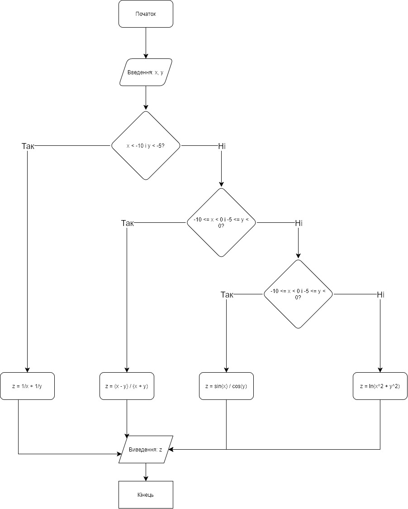
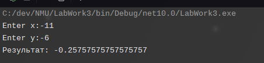
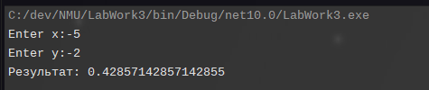
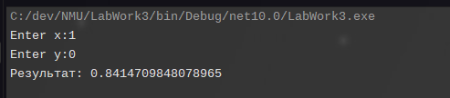
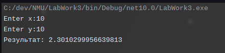

# Лабораторна робота № 3

## Розгалужений обсчислювальний процес
*Варіант №4*
### Мета
Дослідити роботу оператора присвоювання мови програмування C# засвоїти методику складання, налагодження та розрахунку програм лінійних обчислювальних.
### Завдання
- Скласти схему алгоритму та програму **мовою С#** відповідно до заданого варіанта.
- Обчислити значення кускової функції: 
$$f(x, y) = \begin{cases} \frac{1}{x} + \frac{1}{y}, & \text{якщо } x < -10 \text{, } y < -5 \\ \frac{x - y}{x + y}, & \text{якщо } -10 \le x < 0 \text{, } -5 \le y < 0 \\ \frac{\sin(x)}{\cos(y)}, & \text{якщо } 0 \le x < 2\pi \text{, } 0 \le y < \frac{2}{\pi} \\ \log_{10}(x^2 + y^2), & \text{інакше} \end{cases}$$
### Блок-схема алгоритму

### Результати
Було проведено тести для 4-х різних комбінацій значень, щоб отримати кожну з умов.

$x=-11, y=-6$:

---

$x=-5, y=-2$:

---

$x=1, y =0$:

---

$x=10,y=10$:

